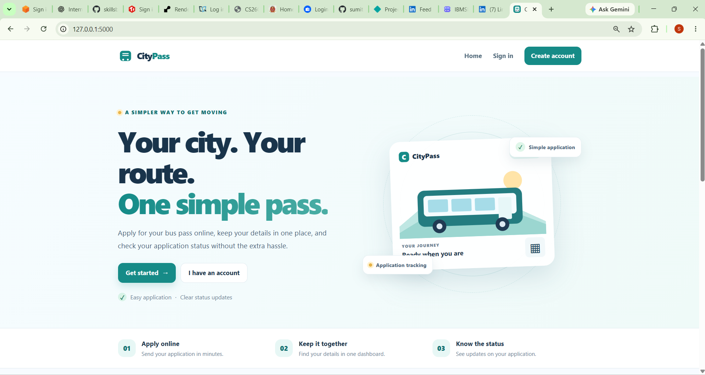
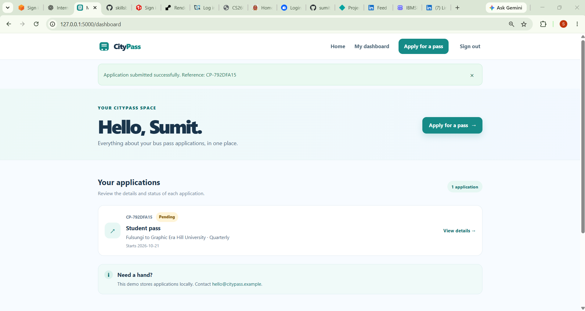
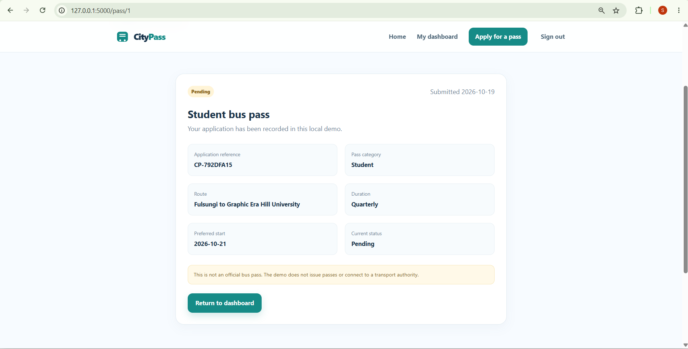

# CityPass — Bus Pass Management System

A modern, responsive Flask web application for applying for and tracking city bus pass applications. Built for educational purposes using Python, Flask, SQLite, HTML, CSS and JavaScript.

**No paid cloud service is required to run the project locally.**

## Table of Contents

- [Overview](#overview)
- [Features](#features)
- [Technology Stack](#technology-stack)
- [Project Structure](#project-structure)
- [Screenshots](#screenshots)
- [Requirements](#requirements)
- [Installation and Setup](#installation-and-setup)
- [Running Tests](#running-tests)
- [How to Use](#how-to-use)
- [Security Features](#security-features)
- [Demo Limitations](#demo-limitations)
- [Future Improvements](#future-improvements)
- [Disclaimer](#disclaimer)

## Overview

CityPass is a local web application that demonstrates how a bus pass application management system can work. Users can create an account, sign in, submit bus pass applications, and review their application details and status through a personal dashboard.

The project focuses on responsive design, basic web security, form validation, and database-backed application management.

## Features

- Responsive, mobile-first user interface
- Collapsible mobile navigation menu
- User registration, sign-in, and sign-out
- Secure password hashing using Werkzeug
- SQLite database with parameterized SQL queries
- Bus pass application form with server-side validation
- Support for Student, Regular, and Senior pass categories
- Monthly and Quarterly pass durations
- Validation to prevent selecting past start dates
- Personal dashboard for submitted applications
- Application reference numbers and status display
- Success and error messages
- CSRF protection for POST requests
- Security-related HTTP response headers
- Custom 400, 404, and 413 error pages
- Page-specific titles and meta descriptions
- Local SVG favicon
- Working navigation and footer links
- Automatically updated copyright year
- Mobile layout and horizontal overflow safeguards
- Automated tests for CSRF protection

## Technology Stack

| Technology | Purpose |
|---|---|
| Python | Application logic |
| Flask | Web framework |
| SQLite | Local database |
| HTML5 | Page structure |
| CSS3 | Responsive styling |
| JavaScript | Client-side interactions |
| Werkzeug | Password hashing and Flask utilities |
| pytest | Automated testing |

## Project Structure

```text
CityPass_Bus_Pass_System/
├── app.py
├── requirements.txt
├── README.md
├── TESTING_CHECKLIST.md
├── .env.example
├── .gitignore
├── citypass.db
├── static/
│   ├── css/
│   │   └── style.css
│   ├── images/
│   │   └── favicon.svg
│   └── js/
│       └── main.js
├── templates/
│   ├── apply.html
│   ├── base.html
│   ├── dashboard.html
│   ├── error.html
│   ├── home.html
│   ├── login.html
│   ├── pass_detail.html
│   └── register.html
└── tests/
    └── test_security.py
```

**Note:** `citypass.db` is created automatically when the application initializes. It is excluded from Git using `.gitignore`, so it may not appear in the GitHub repository.

## Screenshots

Add the following screenshots to `docs/screenshots/` in the repository, using the exact filenames shown below.

### 1. Homepage



### 2. User Dashboard



### 3. Apply for a Pass


### 4. Pass Details



## Requirements

- Python 3.10 or newer
- pip
- Git (optional, for version control)
- A modern web browser

## Installation and Setup

### 1. Clone the repository

```powershell
git clone https://github.com/sumitsaxena2716-sys/CityPass-Bus-Pass-System.git
cd CityPass-Bus-Pass-System
```

Alternatively, download the repository as a ZIP file and extract it.

### 2. Create a virtual environment

```powershell
python -m venv venv
```

### 3. Activate the virtual environment

For Windows PowerShell:

```powershell
Set-ExecutionPolicy -Scope Process -ExecutionPolicy RemoteSigned
.\venv\Scripts\Activate.ps1
```

The execution policy change applies only to the current PowerShell process.

### 4. Install dependencies

```powershell
python -m pip install -r requirements.txt
```

### 5. Configure the Flask secret key

Generate a secret key for your local session:

```powershell
$env:FLASK_SECRET_KEY = (python -c "import secrets; print(secrets.token_hex(32))")
```

Keep the secret key private. For a local demo, generate it again when starting a new PowerShell session. Existing sessions may become invalid when the key changes.

### 6. Run the application

```powershell
python app.py
```

Open the following URL in your browser:

**http://127.0.0.1:5000**

The application creates its SQLite database automatically.

## Running Tests

Make sure your virtual environment is activated and dependencies are installed.

Run the automated tests:

```powershell
python -m pytest -v
```

The current security test suite checks that POST requests without a CSRF token and with an invalid CSRF token are rejected.

**Verified local result:** Both tests passed in the reported test run.

These tests cover specific security checks; they do not constitute a complete security audit.

## How to Use

1. Open the application at `http://127.0.0.1:5000`.
2. Create an account using the registration page.
3. Sign in with your registered credentials.
4. Open **Apply for a pass**.
5. Select a pass category and duration.
6. Enter your usual route and choose a valid start date.
7. Submit the application.
8. Open your dashboard to view the application reference and status.
9. Select **View details** to review the submitted information.

New applications are displayed with a **Pending** status in this educational demo.

## Security Features

The project demonstrates several basic web security practices:

- Passwords are hashed rather than stored as plain text.
- SQL queries use parameterized statements.
- POST forms use CSRF tokens.
- User authentication is required for protected application pages.
- Application details are associated with the signed-in user.
- Form inputs are validated on the server.
- Security-related HTTP response headers are configured.

These measures are educational implementations and do not guarantee that the application is free from vulnerabilities.

## Demo Limitations

CityPass is a local educational demonstration, not an official bus pass service.

The following functionality is not implemented:

- Actual approval or rejection of applications
- Real bus pass generation or issuance
- Online payments
- SMS or email notifications
- Integration with a transport authority
- Live bus routes or transport schedules
- Cloud hosting or production database infrastructure

Application status remains **Pending** because an approval workflow has not been implemented.

The footer currently contains placeholder contact details:

- Phone: `+91 98765 43210`
- Email: `hello@citypass.example`

Replace these before any public-facing deployment. Do not enter real identity documents or sensitive personal information into this demo.

## Future Improvements

Possible future enhancements include:

- An administrator dashboard for reviewing applications
- Approval and rejection workflows
- Email notifications for status changes
- PDF bus pass generation with QR codes
- Improved account recovery and password reset
- More automated tests for authentication and application workflows
- Deployment using a secure production server and managed database
- Accessibility testing and additional browser compatibility checks

These are proposed improvements, not currently implemented features.

## Disclaimer

This project was created for learning and demonstration purposes. It does not issue valid transport passes and is not affiliated with any government department, university, or transport authority.

Before public deployment, configure a stable secret key, HTTPS, secure cookie settings, appropriate database infrastructure, and conduct a thorough security review.

---

**Project:** CityPass — Bus Pass Management System  
**Repository:** [GitHub — CityPass-Bus-Pass-System](https://github.com/sumitsaxena2716-sys/CityPass-Bus-Pass-System)  
**Run locally:** Flask development server on `127.0.0.1:5000`